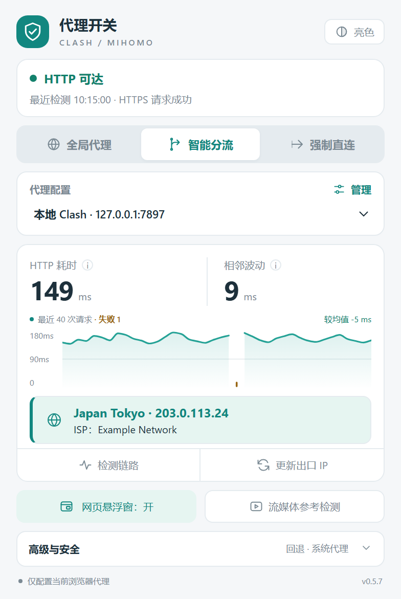
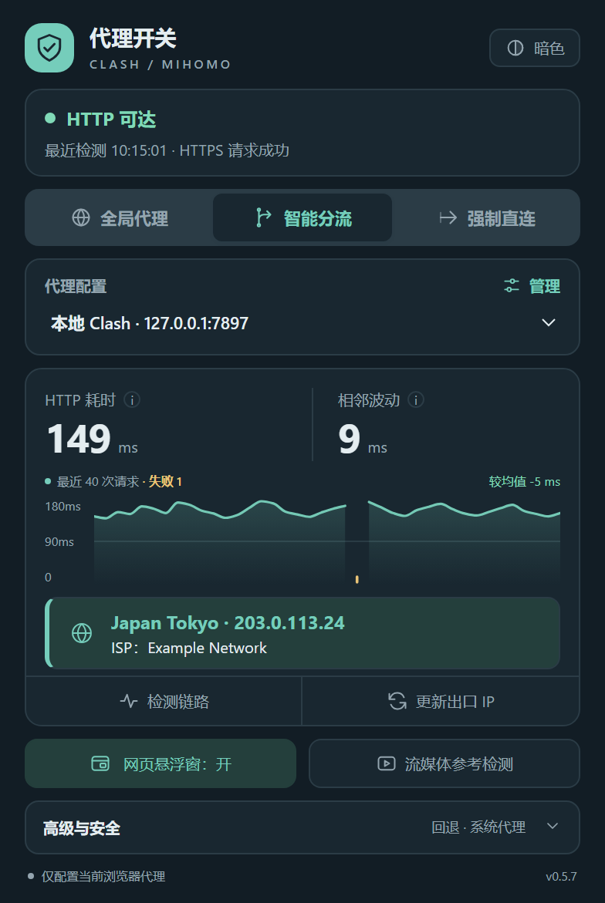
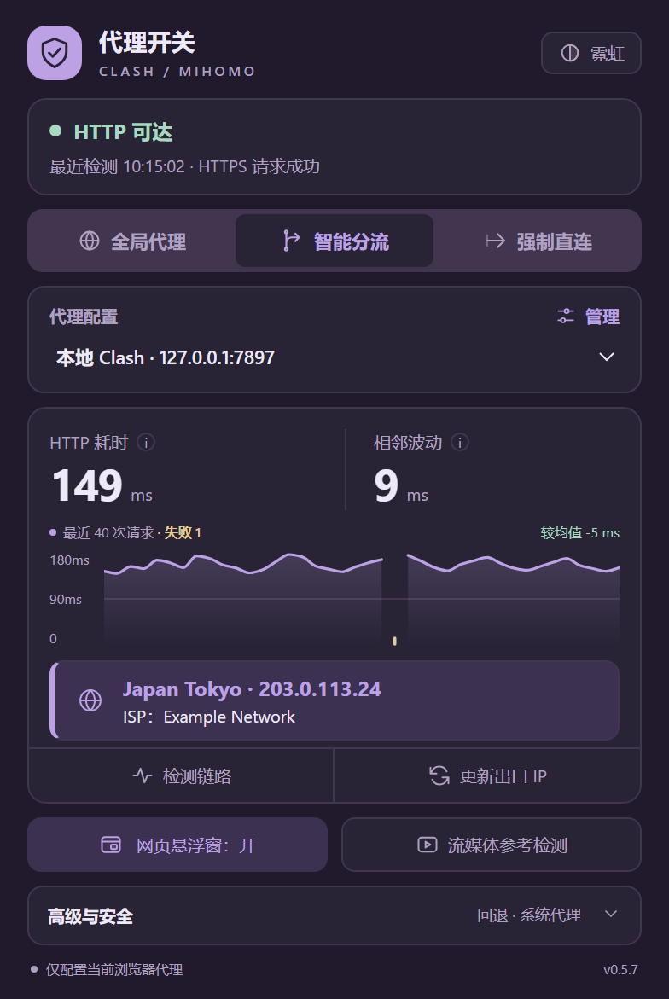

<div align="center">


# 代理开关（Clash / mihomo）

为 Chrome、Edge 一键切换本机 Clash / mihomo 代理，只影响当前浏览器

[](extension/manifest.json)
[](https://developer.chrome.com/docs/extensions/develop/migrate/what-is-mv3)
[](#安装)
[](https://github.com/MetaCubeX/mihomo)

<table>
  <tr>
    <td align="center"><br /><sub>亮色</sub></td>
    <td align="center"><br /><sub>暗色</sub></td>
    <td align="center"><br /><sub>霓虹</sub></td>
  </tr>
</table>

<sub>截图中的状态、延迟和出口地址均为演示数据，出口 IP 使用文档专用地址 203.0.113.0/24。</sub>

</div>

## 简介

Chromium 浏览器的代理切换扩展（Manifest V3），把当前浏览器的流量指向本机运行的 Clash / mihomo。适用于 Chrome、Edge 等 Chromium 浏览器，Edge 已实测可用。

它只通过 `chrome.proxy` 配置浏览器代理，**不是独立 VPN 客户端**：不修改系统代理、不建立 TUN 虚拟网卡、不启动 Clash，也不切换 Clash 内的订阅节点。

## 功能

- 🌐 三种模式：全局代理、智能分流（内网和直连域名列表直连，其余走代理）、强制直连
- 🔓 另可"释放设置"，交还给系统或其他代理决定路由
- 🗂️ 多组代理配置（HTTP / SOCKS5、主机、端口）
- 📈 网络监控：HTTPS 请求耗时、相邻波动、最近 40 次曲线，失败点单独标出
- 📍 出口 IP 查询，以及 YouTube / Netflix 页面可访问性的参考检测
- 🪟 可拖动的网页悬浮窗，支持迷你显示和点击切换模式
- 🎨 亮色、暗色、霓虹三种主题

## 安装

1. 先运行 Clash / mihomo，确认 HTTP（混合）或 SOCKS5 端口。默认配置是 `127.0.0.1:7897`，请按实际端口修改。
2. 如果只想代理浏览器，请在 Clash 里自行关闭系统代理和 TUN。
3. 打开 `chrome://extensions/`（Edge 为 `edge://extensions/`），开启"开发者模式"。
4. 点击"加载已解压的扩展程序"，选择本仓库的 `extension/` 目录。

## 测试

需要较新的 Node.js（已在 Node.js 24 上测试通过），在仓库根目录运行：

```bash
node --test tests/vpn/proxy.test.cjs
```

测试模拟了 Chrome API 和网络请求，不会修改真实的浏览器代理，也不访问外网，因此不能替代装机检查。

## 目录

```text
extension/                       扩展源码（加载这个目录）
  manifest.json
  lib/core.js                    共享的校验、PAC、路由与统计逻辑
  background/service_worker.js   配置队列、代理状态、探测、出口与参考检测
  popup/                         弹窗界面
  content/floating.js            网页悬浮窗
tests/vpn/proxy.test.cjs         回归测试
docs/implementation-plan.md      路线二方案（Native Messaging + mihomo 内核），尚未实现
```

## 详细说明

模式与关闭行为、直连回退的风险、状态含义、监控指标的口径、各版本更新记录和装机检查清单，见 [extension/README.md](extension/README.md)。
