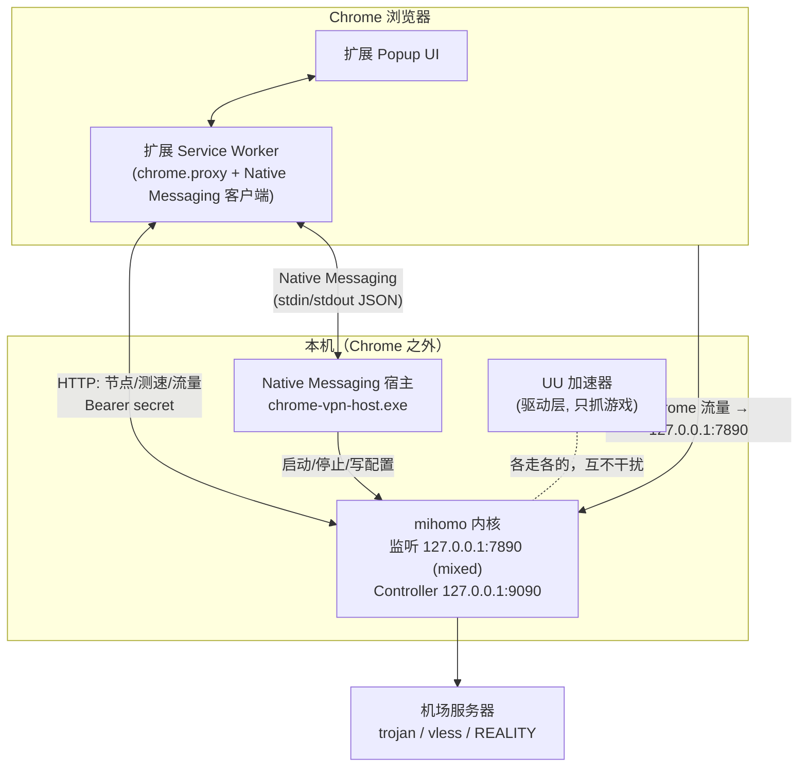
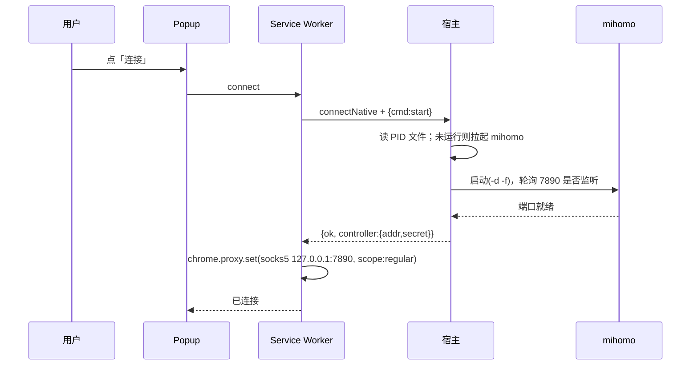
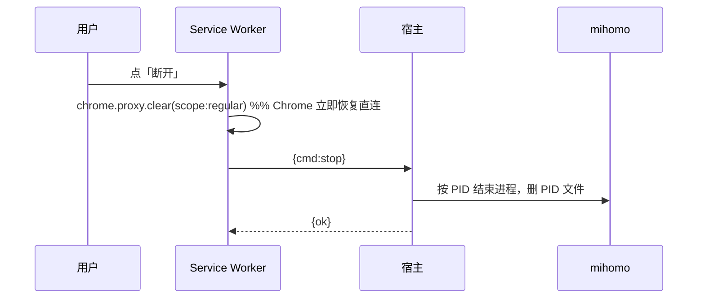
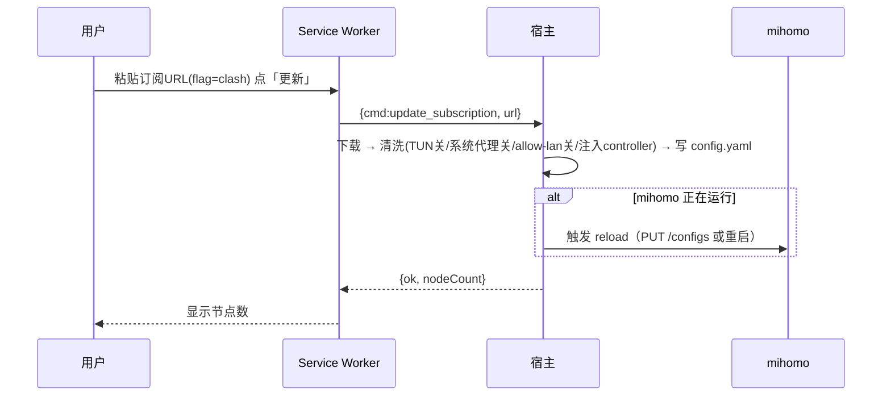

# Chrome 代理插件 · 路线二实施计划（Native Messaging + mihomo 内核）

> 版本：v1.0　|　日期：2026-07-01　|　目标平台：Windows 优先（后续再扩 macOS/Linux）

---

## 1. 背景与目标

### 1.1 背景
- 订阅节点为 **trojan / vless（含 REALITY / xtls-rprx-vision / ECH）**，Chrome 扩展沙箱无法直接实现这些协议（无原始 socket、无法定制 TLS 指纹）。
- 因此协议解密必须交给成熟内核 **mihomo（Clash.Meta）** 完成，扩展只负责 UI 与 Chrome 代理切换。
- 用户本机同时运行 **UU 加速器**，方案必须与之**完全隔离、互不影响**。

### 1.2 目标（本方案要达成）
1. 用户安装"一个产品"（扩展 + 本地宿主 + mihomo），点插件即可让 **Chrome** 走机场节点。
2. mihomo 以**本地进程**形式运行，由扩展通过 **Native Messaging** 遥控（启动/停止/更新订阅）。
3. 只代理 **Chrome**，不改系统代理、不建虚拟网卡、不改路由 → **UU 加速器及其他程序零感知**。
4. 支持订阅导入/更新、节点列表、延迟测速、一键连接/断开。

### 1.3 非目标（本期不做）
- 不在扩展内部实现代理协议（已论证不可行）。
- 不实现 TUN / 全局系统代理（正是与 UU 冲突的根源，明确禁用）。
- 不做移动端；不做订阅协议自研解析（直接复用 mihomo）。

---

## 2. 名词与硬约束

| 名词 | 说明 |
|------|------|
| 扩展 (Extension) | Chrome MV3 插件，负责 UI + `chrome.proxy` 切换 + Native Messaging 客户端 |
| 宿主 (Host) | 本地原生程序，Native Messaging 的另一端，负责进程管理与配置生成 |
| 内核 (mihomo) | 编译好的 mihomo 二进制，真正跑 trojan/vless/REALITY，暴露本地端口 |
| 控制器 (Controller) | mihomo 的 RESTful API（`external-controller`），供节点管理/测速 |

**硬约束（贯穿全程的红线）：**
- mihomo **TUN 关闭**、**系统代理关闭**、`allow-lan: false`、`bind-address: 127.0.0.1`。
- 扩展 `chrome.proxy` 使用 `scope: "regular"`，仅作用于 Chrome。
- 所有本地端口仅绑定 `127.0.0.1`。

---

## 3. 总体架构



### 3.1 职责划分（关键设计）

| 能力 | 谁来做 | 原因 |
|------|--------|------|
| UI / 交互 | 扩展 Popup | 只有扩展能画 UI |
| 切换 Chrome 代理 | 扩展 SW（`chrome.proxy`） | 仅扩展有此 API，`scope: regular` 只影响 Chrome |
| 启动/停止 mihomo 进程 | 宿主 | 扩展无法启动进程 |
| 生成/写 mihomo 配置文件 | 宿主 | 扩展无法写本地文件；且避免大配置走 Native Messaging（宿主→扩展单条消息上限 1MB） |
| 订阅下载 + 清洗（强制 TUN 关等） | 宿主 | 凭据本地化，配置直接落盘 |
| 节点列表 / 测速 / 选节点 / 流量 | 扩展直连 mihomo Controller API | mihomo 已提供 RESTful API，扩展加 `host_permissions` 后可直接 `fetch` |

> **要点**：进程/文件/注册表相关 → 宿主；UI 与运行时查询 → 扩展直连 mihomo API。宿主保持"薄控制层"。

### 3.2 生命周期解耦（重要）
MV3 Service Worker 会在空闲约 30s 后被回收，若把 mihomo 作为"随宿主端口存活"的子进程，SW 一休眠就会断链、杀掉代理。

**对策**：mihomo 生命周期由 **PID 文件**管理，与宿主进程/SW 解耦：
- 宿主是**无状态控制器**：`start`（若未运行则拉起并写 PID 文件）、`stop`（按 PID 结束并删文件）、`status`（读 PID 文件+探活）。
- SW 被回收也不影响：`chrome.proxy` 设置由浏览器持久保存，mihomo 由 PID 文件独立存活，连接不中断。
- 用户下次打开 Popup，SW 唤醒后重新 `connectNative` 查询状态并"重新贴合" UI。

---

## 4. 组件详细设计

### 4.1 Chrome 扩展（MV3）

**目录**
```
extension/
  manifest.json
  background/service_worker.js     # 核心逻辑：native messaging、chrome.proxy、状态机
  background/native.js             # Native Messaging 封装（connectNative/请求-响应）
  background/mihomo-api.js         # 调 mihomo Controller REST API
  popup/popup.html
  popup/popup.js
  popup/popup.css
  common/storage.js               # 订阅/设置读写(chrome.storage.local)
  common/constants.js
  icons/
```

**`manifest.json` 关键点**
```json
{
  "manifest_version": 3,
  "name": "Chrome Proxy (mihomo)",
  "version": "0.1.0",
  "key": "<固定扩展ID用的公钥base64>",
  "permissions": ["proxy", "storage", "nativeMessaging"],
  "host_permissions": ["http://127.0.0.1:9090/*"],
  "background": { "service_worker": "background/service_worker.js", "type": "module" },
  "action": { "default_popup": "popup/popup.html" }
}
```
- `key` 字段固定扩展 ID（见 §7.2），使 Native Messaging 的 `allowed_origins` 能长期匹配。
- `nativeMessaging` 权限用于连接宿主；`host_permissions` 允许直连 mihomo Controller。

**代理切换（核心，仅影响 Chrome）**
```js
// 连接
await chrome.proxy.settings.set({
  scope: "regular",
  value: {
    mode: "fixed_servers",
    rules: {
      singleProxy: { scheme: "socks5", host: "127.0.0.1", port: 7890 },
      bypassList: ["localhost", "127.0.0.1", "::1"]
    }
  }
});
// 断开
await chrome.proxy.settings.clear({ scope: "regular" });
```
- 另监听 `chrome.proxy.onProxyError`，并在设置前读 `levelOfControl` 检测是否被其他扩展抢占，UI 给提示。

### 4.2 Native Messaging 宿主（`chrome-vpn-host`）

- **语言选型：Go（推荐）**。理由：单文件静态二进制、跨平台、进程管理成熟、与 mihomo 同生态；也可用 Node/Python 但需带运行时，更重。
- **通信协议**：Chrome Native Messaging 标准——4 字节小端长度前缀 + UTF-8 JSON，走 stdin/stdout。
- **职责**：
  1. 进程管理：`start` / `stop` / `status`（PID 文件 + 探活）。
  2. 配置生成：下载订阅（`flag=clash`）→ 清洗（§6）→ 写入用户数据目录。
  3. 暴露控制器信息：把随机生成的 `external-controller` 地址与 `secret` 回传扩展。
  4. 崩溃上报：mihomo 异常退出时推事件给扩展。
- **数据目录**：`%LOCALAPPDATA%\ChromeVpn\`
  - `mihomo.exe`、`config.yaml`、`mihomo.pid`、`logs/`、`host.log`。

### 4.3 mihomo 内核
- 固定版本（pin，写进文档与安装器），随产品分发 `mihomo.exe`。
- 启动：`mihomo -d <数据目录> -f <config.yaml>`；宿主捕获 stdout/stderr 写日志。
- 暴露：`mixed-port: 7890`（HTTP+SOCKS 合一，绑 127.0.0.1）、`external-controller: 127.0.0.1:9090`（带随机 secret）。

### 4.4 安装器（Windows 优先）
- 交付物：`install.bat`/安装程序、`chrome-vpn-host.exe`、`mihomo.exe`、`host-manifest.json` 模板、`uninstall.bat`。
- 安装动作：
  1. 释放文件到 `%LOCALAPPDATA%\ChromeVpn\`。
  2. 生成 Native Messaging 清单 `com.chromevpn.host.json`（填绝对 `path` 与 `allowed_origins`）。
  3. 写注册表：`HKCU\Software\Google\Chrome\NativeMessagingHosts\com.chromevpn.host` = 清单路径。
  4. 引导用户加载扩展（或商店安装）。
- 卸载：删注册表键、结束 mihomo、清理目录。

---

## 5. 关键流程时序

### 5.1 连接


### 5.2 断开


### 5.3 订阅更新


### 5.4 节点管理（扩展直连 mihomo API）
- `GET /proxies`：拉分组与节点。
- `GET /proxies/{group}/delay?url=...&timeout=...`：测速。
- `PUT /proxies/{group}` `{ "name": "<node>" }`：切节点。
- `GET /traffic`：实时流量（可选）。
- 请求头：`Authorization: Bearer <secret>`。

---

## 6. mihomo 配置生成与隔离红线（与 UU 共存的核心）

宿主下载 `flag=clash` 订阅后，**强制覆盖**以下字段再落盘（无论订阅原值如何）：

```yaml
allow-lan: false            # 禁止局域网蹭
bind-address: 127.0.0.1     # 仅本地
mixed-port: 7890            # HTTP+SOCKS 合一，仅 127.0.0.1
tun:
  enable: false             # ★ 关键：不建虚拟网卡，不与 UU 抢路由
external-controller: 127.0.0.1:9090
secret: "<每次安装随机生成>"
# 不注入任何"系统代理"相关行为
# 保留订阅原有 proxies / proxy-groups / rules（trojan/vless/REALITY/ECH 原样交给 mihomo）
```

**隔离保证说明：**
- 不开 TUN → 不创建虚拟网卡、不改系统路由表 → 与 UU（驱动层）**物理隔离**。
- 不设系统代理 → 其他 App 的网络设置不被改动。
- 仅 Chrome（经 `chrome.proxy`）连 `127.0.0.1:7890`，其余进程直连。
- **验证方法**：开 UU 打游戏记录延迟 → 再开本方案让 Chrome 走代理 → 游戏延迟应无变化。

---

## 7. 安全设计

### 7.1 通道与端口
- Native Messaging 清单 `allowed_origins` 严格限定本扩展 ID。
- `external-controller` 绑 `127.0.0.1` + **每安装随机 secret**，不暴露 LAN。
- 所有本地端口仅 `127.0.0.1`。

### 7.2 固定扩展 ID
- 生成密钥对，将公钥 base64 写入 `manifest.json` 的 `key` 字段 → 未打包/多机加载时 ID 稳定，保证 `allowed_origins` 长期匹配。

### 7.3 凭据与日志
- 订阅 URL（含 token）视为机密：存 `chrome.storage.local` 与宿主数据目录，**日志中脱敏**。
- 宿主只接受白名单 `cmd`；订阅 URL 仅允许 `https`。

---

## 8. 项目目录结构（总）

```
Chrome Vpn/
  docs/implementation-plan.md        # 本文档
  extension/                         # MV3 扩展（§4.1）
  host/                              # Go 宿主源码
    main.go
    nativemsg/                       # 长度前缀编解码
    mihomo/                          # 进程管理 + 配置清洗
    subscription/                    # 下载 + 解析
  third_party/mihomo/                # 固定版本二进制（构建期放入）
  installer/
    install.ps1 / install.bat
    uninstall.ps1 / uninstall.bat
    com.chromevpn.host.json.tmpl
  README.md
```

---

## 9. 里程碑与任务拆解

| 里程碑 | 目标 | 关键任务 | 验收标准 |
|--------|------|----------|----------|
| **M0 骨架打通** | 扩展 ↔ 宿主能通信 | 扩展 skeleton；宿主 skeleton；`ping/pong` 往返；注册表手动配置 | Popup 点按钮，宿主回 pong |
| **M1 内核生命周期** | 宿主能管 mihomo | PID 文件方案；`start/stop/status`；日志 | 用固定测试配置，能拉起/停掉 mihomo |
| **M2 订阅与清洗** | 配置自动生成 | 下载订阅；YAML 清洗（强制红线字段）；写盘；reload | 你的订阅生成的 config 中 TUN=false 等全部命中，56 节点加载成功 |
| **M3 代理联动** | Chrome 走代理 | `connect/disconnect` 接 `chrome.proxy`；`levelOfControl`/`onProxyError` | Chrome IP 变化；其他 App/UU 延迟不变 |
| **M4 节点管理 UI** | 可视化选节点 | 拉 `/proxies`、测速、切节点、流量 | Popup 列表可选、可测速、切换生效 |
| **M5 安装器 + 固定ID** | 一键安装 | manifest `key` 固定 ID；注册表脚本；打包 | 干净机器一键装好可用，一键卸载干净 |
| **M6 健壮性打磨** | 生产可用 | SW 休眠重连、mihomo 崩溃重启、端口占用、错误提示 | 异常场景均有明确 UI 反馈，代理不"假连接" |
| **M7 跨平台（可选）** | mac/Linux | 路径/注册方式适配 | macOS 可用 |

---

## 10. 技术选型

| 项 | 选型 | 备注 |
|----|------|------|
| 扩展 | MV3 + 原生 JS（可后接框架） | 首版原生 JS，减小复杂度 |
| 宿主 | Go | 单文件、跨平台、进程管理强 |
| 内核 | mihomo（固定版本） | 直接复用，支持 REALITY/ECH/vision |
| 通信 | Native Messaging（长度前缀 JSON） | 标准机制 |
| 节点控制 | mihomo Controller REST | 扩展直连，减轻宿主 |
| 安装 | PowerShell/bat + 注册表 | Windows 优先 |

---

## 11. 风险与对策

| 风险 | 影响 | 对策 |
|------|------|------|
| MV3 SW 被回收断链 | 代理"假断开" | mihomo 由 PID 文件独立存活，与 SW 解耦（§3.2） |
| 扩展 ID 变动致宿主拒连 | 无法通信 | `manifest.key` 固定 ID |
| 与 UU 冲突 | 游戏掉线/加速失效 | 强制 TUN/系统代理关闭（§6），并做隔离回归测试 |
| 端口被占用 | 启动失败 | 端口可配 + 启动前探测 + 失败提示 |
| 杀软误报 mihomo/宿主 | 装不上 | 后续做代码签名；文档提示加白名单 |
| mihomo 版本/字段漂移 | 配置不兼容 | pin 版本；清洗器按版本适配 |
| 路径含空格 | 启动失败 | 全程引号 + 绝对路径 |
| 订阅含高级传输(REALITY/ECH) | 部分内核跑不通 | 用支持它们的 mihomo 版本；M2 用真实订阅回归 |

---

## 12. 测试计划

- **配置清洗单测**：任意订阅输入，输出必满足 TUN=false / allow-lan=false / bind 127.0.0.1 / 有 controller+secret。
- **连通性**：连接后 `curl -x socks5h://127.0.0.1:7890 https://api.ipify.org` 返回节点出口 IP；Chrome 内实测 IP 变化。
- **隔离回归（重点）**：UU 打游戏延迟对照（开/不开本方案）应无变化；系统其他 App 出口 IP 不变。
- **异常**：mihomo 崩溃→UI 报错并可重连；订阅失效→明确提示；SW 休眠→再唤醒状态正确；端口占用→提示改端口。
- **安装/卸载**：干净虚拟机一键装好可用；卸载后注册表/进程/文件清理干净。

---

## 13. 交付物清单
1. `extension/`：可加载的 MV3 扩展。
2. `host/`：Go 宿主源码 + 编译产物 `chrome-vpn-host.exe`。
3. `third_party/mihomo/mihomo.exe`：固定版本内核。
4. `installer/`：安装/卸载脚本 + Native Messaging 清单模板。
5. `README.md`：安装、使用、与 UU 共存说明、故障排查。

---

## 附录 A：Native Messaging 消息协议（草案）

**扩展 → 宿主（请求）**
```jsonc
{ "id": "uuid", "cmd": "ping" }
{ "id": "uuid", "cmd": "status" }
{ "id": "uuid", "cmd": "start" }
{ "id": "uuid", "cmd": "stop" }
{ "id": "uuid", "cmd": "restart" }
{ "id": "uuid", "cmd": "update_subscription", "params": { "url": "https://..." } }
{ "id": "uuid", "cmd": "get_controller_info" }
```

**宿主 → 扩展（响应）**
```jsonc
{ "id": "uuid", "ok": true,  "data": { "running": true, "port": 7890, "controller": { "addr": "127.0.0.1:9090", "secret": "xxxx" }, "nodeCount": 56 } }
{ "id": "uuid", "ok": false, "error": "描述信息" }
```

**宿主 → 扩展（异步事件）**
```jsonc
{ "event": "mihomo_exited", "code": 1 }
{ "event": "log", "level": "error", "msg": "..." }
```

---

## 附录 B：一句话总览
> **扩展管 UI 与 Chrome 代理开关，宿主管 mihomo 进程与配置，mihomo 管协议与出网；全程不开 TUN、不设系统代理，因此与 UU 加速器彻底隔离、互不影响。**
